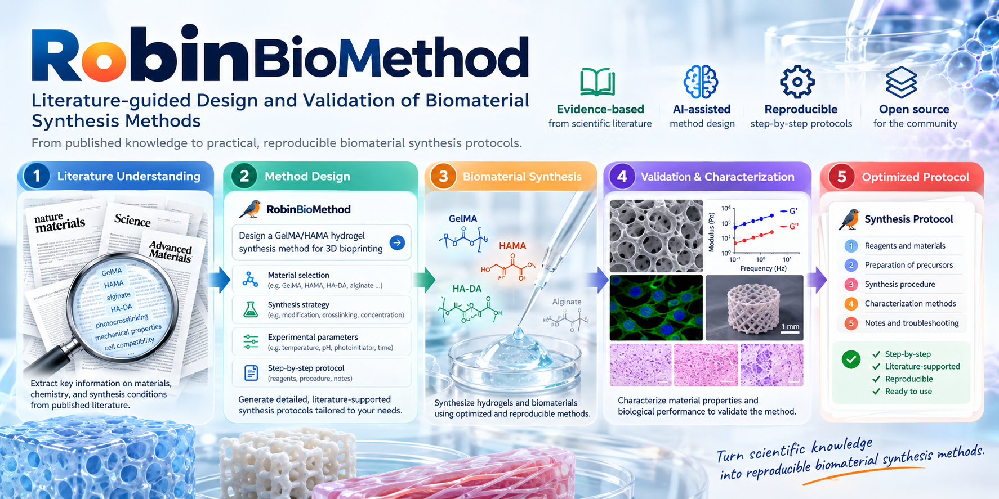

# RobinBioMethod

*概念流程示意：软件交付候选方法和验证计划；材料合成与实际效果验证仍需在实验室完成。*
基于 Harness² 的独立 Codex 插件，用于：

**目标与实验约束 → 文献检索 → 方法取证 → INV／DOM 修正 → 候选 method＋最小验证实验。**

流程适用于不同生物材料；GelMA 只是首个公开案例。不依赖 GelMA 透析计算器。

## 安装与入口

需要 macOS／Linux、Python3.12或3.13。真实模型试验还需要 Codex CLI0.147.0以上版本、
文件形式的登录及可用额度。离线案例与文档检查无需模型调用或登录。

在完整源码目录内执行：

    codex plugin marketplace add .
    codex plugin add robin-biomethod@robin-biomethod

也可以直接从 GitHub 安装：

    codex plugin marketplace add Yaobin29/robin-biomethod --ref main
    codex plugin add robin-biomethod@robin-biomethod

打开新聊天，调用 $biomethod-setup 或 $biomethod-design。选择器可能显示
robin-biomethod:biomethod-setup／robin-biomethod:biomethod-design。
不要求安装 Robin 的其他全局 skill，也不继承私人 Notion 地址或本机路径。

## 怎样使用

告诉 Codex 材料、用途、目标指标及其定义和测定方法、允许偏差、合成规模、原料、
可用设备和硬约束。缺少会改变路线选择的信息时，先澄清。

检索先找候选文献，再读取 Methods、关键 Results 和补充材料，提取带出处的方法卡片。
只找到摘要时，不把它当作完整方法。默认采用材料通用规则，可按任务加入材料专业检查。

- INV：改善取证、计算、来源追踪、约束和完整性检查。
- DOM：改善材料机制、条件关联、路线适用性、表征和实验判断。
- AGG：根据实际输出合并规则、选择一个或保留基线；不把不同配方强行拼接。

检索在优化循环之前完成。目标和证据冻结后再公平比较，模型执行期间不联网补证。
具体参数属于本次任务证据；不能直接变成跨材料通用规则。

可以只在当前聊天中撰写有证据的方法，再调用检查和报告工具。要运行原库真实
INV／DOM 试验，需明确提出并确定预算；程序不会把普通写方法请求自动变成模型试验。
默认16会话／45分钟，失败和重试也计入；不提供科学方法自动采用命令。

## 先看离线案例

    python3.12 plugins/robin-biomethod/scripts/biomethod.py demo --out /path/to/new-example

生成 method.md、结构化方法和检查结果。示例由当前对话整理公开文献，零模型调用，
不代表自主优化成功。70±5%初级胺转化率和5g原料规模是明确的假设需求。

案例保留两条不同原料和条件的路线，缺设备的TFF路线仅作参考。目标投料校准、
纯化条件及终点仍有缺口，所以交付为候选草案，并给出可证伪的最小验证实验。
独立合成批次与技术重复分别记录；示例数量是先导研究建议，不是假定统计功效。

文档检查只覆盖结构、引用、所声明的计算和规则一致性；不能证明化学解释正确、
反应成功、纯度、生物相容性或安全性。目标达到与否、纯化终点和适用性需要实验。

## 整合了哪些能力

| 原有能力 | 本插件采用的部分 |
| --- | --- |
| paper-3w-research | 检索记录、去重、WHY／HOW／WHAT及入选理由 |
| paper-method-sop | 方法分段、步骤参数、缺失信息标记 |
| research-gap-to-idea | 证据边界、条件可比性、假设与最小验证实验 |
| paper-explain-concept | 关键文献的按需深读 |
| PDF解析／Zotero | 可选输入；不作为私人环境依赖 |

这些是为当前任务重写的适配能力，不是把私人 skill 整包复制进来。
Notion同步、实验结果回流、NMR定量分析和专用过程模型暂不包含。

详细命令、目标与方法卡片格式见 README.md 和插件 references/task-format.md。
运行态默认位于 ~/.local/share/robin-biomethod。真实完成边界见 VALIDATION.md。
公开仓库：https://github.com/Yaobin29/robin-biomethod

插件不自动发布你的实验材料。独立项目，非 Google 或 OpenAI 官方产品。
